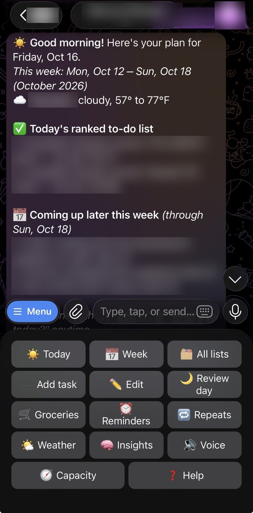
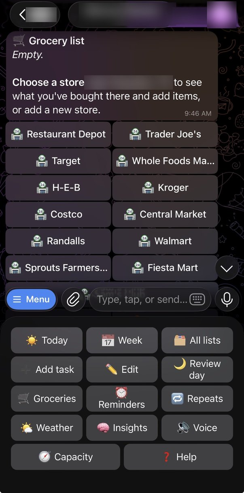
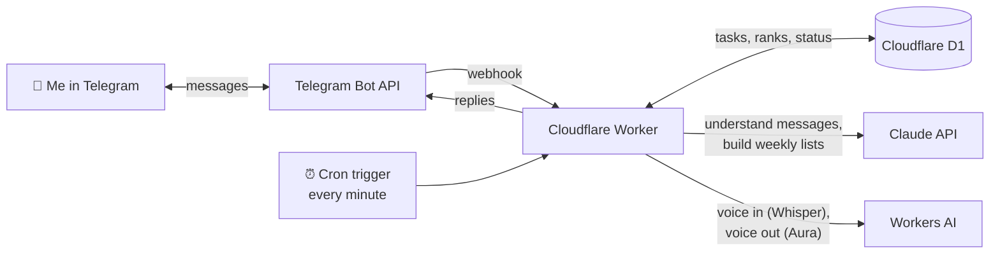

# Telegram Planner Bot

[](https://github.com/mykel23/telegram-planner-bot/actions/workflows/ci.yml)

A personal planning assistant that lives in Telegram. Every morning it messages me my ranked to-do list. Every Sunday evening it runs a check-in: I list what I need to get done, rank each item, and get back my month, week and day priorities. In between, I can text it things like "done with the deck" or "add call the bank" and it keeps my lists up to date.

It runs on Cloudflare Workers, stores data in Cloudflare D1, uses Claude to understand plain-English messages, and costs under $1 a month to run.

## The problem

To-do apps wait for you to open them. I wanted a planner that comes to me: a short, ranked plan at the start of each day and a weekly moment to step back and reprioritize, in the chat app I already have open, with no app to remember to check.

## What it does

| When | What happens |
|---|---|
| **Every morning (7:00 AM)** | The bot sends the weather, today's ranked to-do list, what I'm currently working on, and what's coming up later this week. |
| **Every evening (8:00 PM)** | The bot goes through today's list one task at a time and asks if it got done. I reply yes, no (it rolls over to tomorrow), a new day, or drop. |
| **Weekly check-in (Sunday 6:00 PM)** | Plans the Monday-to-Sunday week ahead. The bot asks what I need to get done this week or month. For each task it asks for a rank from 1 to 5, the day I'd like to do it, and the latest day it can be done. Then it sends my month, week and day lists, with dates. |
| **Anytime** | I text it in plain English: "add renew passport this month", "done with the bank", "working on the deck", "what's on today?" |
| **Voice notes** | I can send a voice note instead of typing. The bot transcribes it and treats it like a text. |
| **Reminders** | "Remind me to call the bank at 2pm" sends a nudge at exactly that time. |
| **Repeating tasks** | "Add gym every Mon, Wed and Fri" or "pay rent on the 1st of every month" come back on their own. A missed one is replaced by the next, so they never pile up. |
| **Stuck tasks** | If a task gets pushed back three times, the bot asks whether to split it into smaller steps, move it to the month list, drop it or keep it. |
| **Categories** | Tasks can be tagged Work, Personal, Health and so on, and `/work` shows just that category. The bot suggests categories on its own. |
| **It learns how I work** | Every evening answer is logged. From the last four weeks the bot works out how much I really finish per day, my strongest and weakest days, and what keeps slipping, and plans around it. `/insights` shows what it has learned. I can also tell it things like "remember I'm caring for my dad this month". |
| **Monthly capacity check** | At the first weekly check-in of each month the bot asks how much I can realistically take on right now (light, normal or full) and caps each day's list to match. |
| **Voice replies** | With a voice picked in `/voice`, the bot reads the morning plan and reminders aloud and answers voice notes with voice notes. |
| **Home menu** | A button menu stays at the bottom of the chat (Today, Week, Add task, Edit, Review day, Reminders and more). `/menu` greets me with a quick status. |
| **Buttons** | Check-ins and edits show tap buttons (Done, Tomorrow, Drop, ranks, weekdays), so most answers are one tap. |
| **Tap to finish** | Every list and the morning message have a ✅ button per task. Tapping it marks the task done and redraws the list in place. |
| **Weather** | The morning message includes the day's forecast (Open-Meteo, free, no key). `/weather` sets the city, or I can share my location. |
| **Grocery list** | `/grocery` keeps a list grouped by store. The first time, it asks for my ZIP code and turns the grocery stores near me into buttons within 10 miles (OpenStreetMap, free, no key); I can add my own stores too. I pick a store first, then send several items at once ("milk, eggs and bread"). Each store remembers what I bought there and shows those items as ➕ buttons next time, so nothing is added without asking. In the store I tap ✅ to check items off. |

## Demo

 

*Left: the 7 AM good morning message, with the home menu underneath. Right: the grocery list, with the stores near my ZIP code as buttons. Personal details are blurred.*

> More screenshots and a short GIF will be added after launch (see the [launch milestone](https://github.com/mykel23/telegram-planner-bot/milestones)).

## Architecture



- **Telegram → Worker:** Telegram delivers each message to the Worker's `/telegram` webhook. A secret header proves the request really came from Telegram.
- **Cron["⏰ Cron trigger<br/>every minute"]→ Worker:** Cloudflare runs the Worker every minute. The code converts the time to my time zone and sends reminders, adds the day's repeating tasks, and sends the morning message, the evening check-in or the weekly check-in when each is due. This keeps 7:00 AM at 7:00 AM through daylight saving changes, which a fixed UTC cron can't do.
- **Worker → Claude:** Claude turns free-form messages into structured actions (add, done, start, update, remove, show) and sorts tasks into month, week and day lists after the check-in. Both calls use [structured outputs](https://docs.claude.com/en/docs/build-with-claude/structured-outputs), so the bot always gets valid JSON back.
- **Worker → Workers AI:** Voice notes are downloaded from Telegram and transcribed with Whisper on Cloudflare's own AI service, then handled like a typed message. Spoken replies use Deepgram Aura voices on the same service.
- **Worker → D1:** Tasks, ranks, status, repeating tasks, reminders and the check-in's progress are stored in a SQLite database, so nothing is lost when the Worker restarts or redeploys.

### Design decisions

- **It keeps working if Claude is down.** If a Claude call fails, simple built-in rules handle `add`, `done`, `working on` and `what's on today?`, and the weekly lists fall back to rank-based sorting.
- **Scheduled messages retry themselves.** A message is marked "sent" only after Telegram accepts it. If a send fails, the next run tries again, within a two-hour window. Each scheduled job runs on its own, so one failing never blocks the others.
- **Buttons are just text.** Every button sends words the bot already understands, so typing the answer works just as well as tapping.
- **Only I can use it.** The first person to send `/start` becomes the owner, and the bot ignores everyone else.
- **No secrets in the repo.** The bot token, API key and webhook secret live in Cloudflare's encrypted secrets. `wrangler.toml` holds only non-secret settings.
- **Low cost.** Claude Haiku handles the language work, and the daily message is built without an AI call at all.

## Running cost

| Service | Monthly cost |
|---|---|
| Cloudflare Workers, cron triggers, D1 (free plan) | $0 |
| Workers AI voice in and out (free daily allowance) | $0 |
| Telegram Bot API | $0 |
| Claude API (Haiku, about 30 daily messages, 4 check-ins and a few replies a day) | well under $1 |
| **Total** | **under $1** |

## Commands

| Message | What it does |
|---|---|
| `add call the bank` | Adds a task to this week's list (rank 3) |
| `add finish deck today, rank 1` | Adds a task to today's list with rank 1 |
| `done with the bank` | Marks a task done |
| `working on the deck` | Marks a task as in progress |
| `move the deck to this month` / `make the deck rank 2` | Changes a task's list or rank |
| `the deck is due Friday` / `I'd like to do the deck Wednesday` | Sets a task's latest day or preferred day |
| `what's on today?` | Shows today's list |
| `add gym every Mon, Wed and Fri` | Adds a repeating task |
| `stop repeating gym` | Stops a repeating task |
| `remind me to call the bank at 2pm` / `remind me in 20 minutes to stretch` | Sets a reminder |
| `add dentist, category Health` | Adds a task with a category |
| 🎙 a voice note | Works like typing the same words |
| `/repeats` `/reminders` `/categories` | Shows repeating tasks, upcoming reminders or categories |
| `remember I work nights on Tuesdays` / `/memory` | Tells the bot something to plan around / shows what it remembers |
| `/insights` | What the bot has learned about how I work |
| `/capacity` | Light, normal or full: how many tasks a day to plan |
| `/voice` | Pick a voice for spoken replies, or turn it off |
| `/menu` | Greeting, quick status and the button menu |
| `/work`, `/health`, … | Shows one category's tasks |
| `/today` `/week` `/month` `/lists` | Shows lists |
| `/grocery` / `add milk and eggs to my grocery list` | Grocery list by store, with past items as buttons |
| `/weather` | Sets the city for the morning forecast |
| `/edit` | Guided edit: pick a task by number, then change its rank, preferred day, latest day, name, list or category |
| `/checkin` | Starts the weekly check-in now |
| `/morning` | Sends the good morning message now |
| `/review` | Starts the evening check-in now |
| `/cancel` | Stops a check-in, edit or evening review in progress |

Ranks go from 1 (most important) to 5.

## Set up your own

Everything is done in the browser. No software to install.

1. **Create a Telegram bot.** In Telegram, message [@BotFather](https://t.me/BotFather), send `/newbot`, and follow the prompts. Keep the token it gives you private.
2. **Get a Claude API key** at [console.anthropic.com](https://console.anthropic.com) and add a few dollars of credit.
3. **Fork this repo.**
4. **Create the database.** In the [Cloudflare dashboard](https://dash.cloudflare.com), go to **Storage & Databases → D1 → Create**, name it `planner-db`, and copy its **Database ID** into `database_id` in `wrangler.toml`.
5. **Connect the repo.** Go to **Workers & Pages → Create → Import a repository**, pick your fork, and deploy. Every push to `main` now redeploys the bot automatically.
6. **Add the secrets.** In the Worker, open **Settings → Variables and Secrets** and add three secrets:
   - `TELEGRAM_BOT_TOKEN`: the token from BotFather
   - `ANTHROPIC_API_KEY`: your Claude API key
   - `TELEGRAM_WEBHOOK_SECRET`: a long random string you make up (letters, numbers, `_` and `-` only)
7. **Connect Telegram.** Open `https://<your-worker>.workers.dev/setup?key=<your TELEGRAM_WEBHOOK_SECRET>` in your browser.
8. **Say hello.** Send `/start` to your bot. You're now its owner.

To change the schedule or time zone, edit `TIMEZONE`, `DAILY_HOUR`, `EVENING_HOUR`, `WEEKLY_DAY` and `WEEKLY_HOUR` in `wrangler.toml` and push.

To check that scheduled messages are going out, open `https://<your-worker>.workers.dev/status?key=<your TELEGRAM_WEBHOOK_SECRET>`. It lists recent sends without showing any task data.

## Development

```bash
npm install
npm test            # unit tests (time zones, parsing, formatting)
npm run typecheck
cp .dev.vars.example .dev.vars   # then fill in test values
npm run dev         # local Worker with a local D1 database
```

## How the build is managed

The build is tracked in [GitHub Issues](https://github.com/mykel23/telegram-planner-bot/issues) under the milestone **Launch by Oct 31**, with a clear definition of done:

- The daily message arrives on time 7 days in a row, for a full Monday-to-Sunday week
- The weekly check-in ranks every task and returns month, week and day lists
- "done" and "add" update the lists correctly
- Data survives restarts

## How I built this with Claude

*Draft: Marcus will personalize this section.*

I'm a project manager, not a full-time developer, so I worked with Claude the way I'd work with an engineer on my team. I owned the what and the why, and Claude did the hands-on building.

- **I set the scope and constraints.** I wrote a one-page brief: the problem, how it should work, the tech stack, a deadline (October 31, 2026), a budget (under $5 a month) and a concrete definition of done.
- **Claude proposed the plan and the defaults.** It turned the brief into a step-by-step build plan, suggested defaults for the open decisions (time zone, schedule, storage), and flagged risks I hadn't considered, such as daylight saving time breaking a fixed cron schedule.
- **I made the calls.** I chose to make the repo public as a portfolio piece, set up auto-deploys from GitHub, and track the work in GitHub Issues with a launch milestone.
- **Claude wrote and tested the code.** It wrote the Worker, the database layer and the Claude integration, plus unit tests that simulate a full week of hourly cron runs across the daylight saving change. It also tested the whole bot locally against a fake Telegram server before anything was deployed.
- **Ground rules kept it safe.** Keys never go into chat or the repo, only into Cloudflare secrets. Setup happens one step at a time, and Claude checks with me before creating anything new on GitHub.

## License

[MIT](LICENSE)
