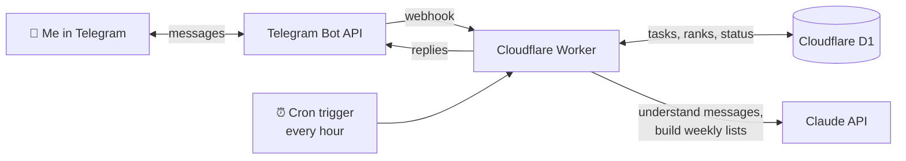

# Telegram Planner Bot

[](https://github.com/mykel23/telegram-planner-bot/actions/workflows/ci.yml)

A personal planning assistant that lives in Telegram. Every morning it messages me my ranked to-do list. Every Sunday evening it runs a check-in: I list what I need to get done, rank each item, and get back my month, week and day priorities. In between, I can text it things like "done with the deck" or "add call the bank" and it keeps my lists up to date.

It runs on Cloudflare Workers, stores data in Cloudflare D1, uses Claude to understand plain-English messages, and costs under $1 a month to run.

## The problem

To-do apps wait for you to open them. I wanted a planner that comes to me: a short, ranked plan at the start of each day and a weekly moment to step back and reprioritize, in the chat app I already have open, with no app to remember to check.

## What it does

| When | What happens |
|---|---|
| **Every morning (7:00 AM)** | The bot sends today's ranked to-do list, what I'm currently working on, and what's up next this week. |
| **Weekly check-in (Sunday 6:00 PM)** | The bot asks what I need to get done, asks me to rank each new task from 1 to 5, then sends my month, week and day lists. |
| **Anytime** | I text it in plain English: "add renew passport this month", "done with the bank", "working on the deck", "what's on today?" |

## Demo

> Screenshots and a short GIF of the bot in action will be added after launch (see the [launch milestone](https://github.com/mykel23/telegram-planner-bot/milestones)).

## Architecture



- **Telegram → Worker:** Telegram delivers each message to the Worker's `/telegram` webhook. A secret header proves the request really came from Telegram.
- **Cron → Worker:** Cloudflare runs the Worker every hour. The code converts the time to my time zone and sends the morning message or starts the check-in when it's due. This keeps 7:00 AM at 7:00 AM through daylight saving changes, which a fixed UTC cron can't do.
- **Worker → Claude:** Claude turns free-form messages into structured actions (add, done, start, update, remove, show) and sorts tasks into month, week and day lists after the check-in. Both calls use [structured outputs](https://docs.claude.com/en/docs/build-with-claude/structured-outputs), so the bot always gets valid JSON back.
- **Worker → D1:** Tasks, ranks, status and the check-in's progress are stored in a SQLite database, so nothing is lost when the Worker restarts or redeploys.

### Design decisions

- **It keeps working if Claude is down.** If a Claude call fails, simple built-in rules handle `add`, `done`, `working on` and `what's on today?`, and the weekly lists fall back to rank-based sorting.
- **Scheduled messages retry themselves.** A message is marked "sent" only after Telegram accepts it. If a send fails, the next hourly run tries again, within a two-hour window.
- **Only I can use it.** The first person to send `/start` becomes the owner, and the bot ignores everyone else.
- **No secrets in the repo.** The bot token, API key and webhook secret live in Cloudflare's encrypted secrets. `wrangler.toml` holds only non-secret settings.
- **Low cost.** Claude Haiku handles the language work, and the daily message is built without an AI call at all.

## Running cost

| Service | Monthly cost |
|---|---|
| Cloudflare Workers, cron triggers, D1 (free plan) | $0 |
| Telegram Bot API | $0 |
| Claude API (Haiku, about 30 daily messages, 4 check-ins and a few replies a day) | well under $1 |
| **Total** | **under $1** |

## Commands

| Message | What it does |
|---|---|
| `add call the bank` | Adds a task to this week's list (rank 3) |
| `add finish deck today, rank 1` | Adds a task to today's list with rank 1 |
| `done with the bank` | Marks a task done |
| `working on the deck` | Marks a task as in progress |
| `move the deck to this month` / `make the deck rank 2` | Changes a task's list or rank |
| `what's on today?` | Shows today's list |
| `/today` `/week` `/month` `/lists` | Shows lists |
| `/checkin` | Starts the weekly check-in now |
| `/daily` | Sends the morning message now |
| `/cancel` | Stops a check-in in progress |

Ranks go from 1 (most important) to 5.

## Set up your own

Everything is done in the browser. No software to install.

1. **Create a Telegram bot.** In Telegram, message [@BotFather](https://t.me/BotFather), send `/newbot`, and follow the prompts. Keep the token it gives you private.
2. **Get a Claude API key** at [console.anthropic.com](https://console.anthropic.com) and add a few dollars of credit.
3. **Fork this repo.**
4. **Create the database.** In the [Cloudflare dashboard](https://dash.cloudflare.com), go to **Storage & Databases → D1 → Create**, name it `planner-db`, and copy its **Database ID** into `database_id` in `wrangler.toml`.
5. **Connect the repo.** Go to **Workers & Pages → Create → Import a repository**, pick your fork, and deploy. Every push to `main` now redeploys the bot automatically.
6. **Add the secrets.** In the Worker, open **Settings → Variables and Secrets** and add three secrets:
   - `TELEGRAM_BOT_TOKEN`: the token from BotFather
   - `ANTHROPIC_API_KEY`: your Claude API key
   - `TELEGRAM_WEBHOOK_SECRET`: a long random string you make up (letters, numbers, `_` and `-` only)
7. **Connect Telegram.** Open `https://<your-worker>.workers.dev/setup?key=<your TELEGRAM_WEBHOOK_SECRET>` in your browser.
8. **Say hello.** Send `/start` to your bot. You're now its owner.

To change the schedule or time zone, edit `TIMEZONE`, `DAILY_HOUR`, `WEEKLY_DAY` and `WEEKLY_HOUR` in `wrangler.toml` and push.

To check that scheduled messages are going out, open `https://<your-worker>.workers.dev/status?key=<your TELEGRAM_WEBHOOK_SECRET>`. It lists recent sends without showing any task data.

## Development

```bash
npm install
npm test            # unit tests (time zones, parsing, formatting)
npm run typecheck
cp .dev.vars.example .dev.vars   # then fill in test values
npm run dev         # local Worker with a local D1 database
```

## How the build is managed

The build is tracked in [GitHub Issues](https://github.com/mykel23/telegram-planner-bot/issues) under the milestone **Launch by Oct 31**, with a clear definition of done:

- The daily message arrives on time 7 days in a row
- The weekly check-in ranks every task and returns month, week and day lists
- "done" and "add" update the lists correctly
- Data survives restarts

## How I built this with Claude

*Draft: Marcus will personalize this section.*

I'm a project manager, not a full-time developer, so I worked with Claude the way I'd work with an engineer on my team. I owned the what and the why, and Claude did the hands-on building.

- **I set the scope and constraints.** I wrote a one-page brief: the problem, how it should work, the tech stack, a deadline (October 31, 2026), a budget (under $5 a month) and a concrete definition of done.
- **Claude proposed the plan and the defaults.** It turned the brief into a step-by-step build plan, suggested defaults for the open decisions (time zone, schedule, storage), and flagged risks I hadn't considered, such as daylight saving time breaking a fixed cron schedule.
- **I made the calls.** I chose to make the repo public as a portfolio piece, set up auto-deploys from GitHub, and track the work in GitHub Issues with a launch milestone.
- **Claude wrote and tested the code.** It wrote the Worker, the database layer and the Claude integration, plus unit tests that simulate a full week of hourly cron runs across the daylight saving change. It also tested the whole bot locally against a fake Telegram server before anything was deployed.
- **Ground rules kept it safe.** Keys never go into chat or the repo, only into Cloudflare secrets. Setup happens one step at a time, and Claude checks with me before creating anything new on GitHub.

## License

[MIT](LICENSE)
